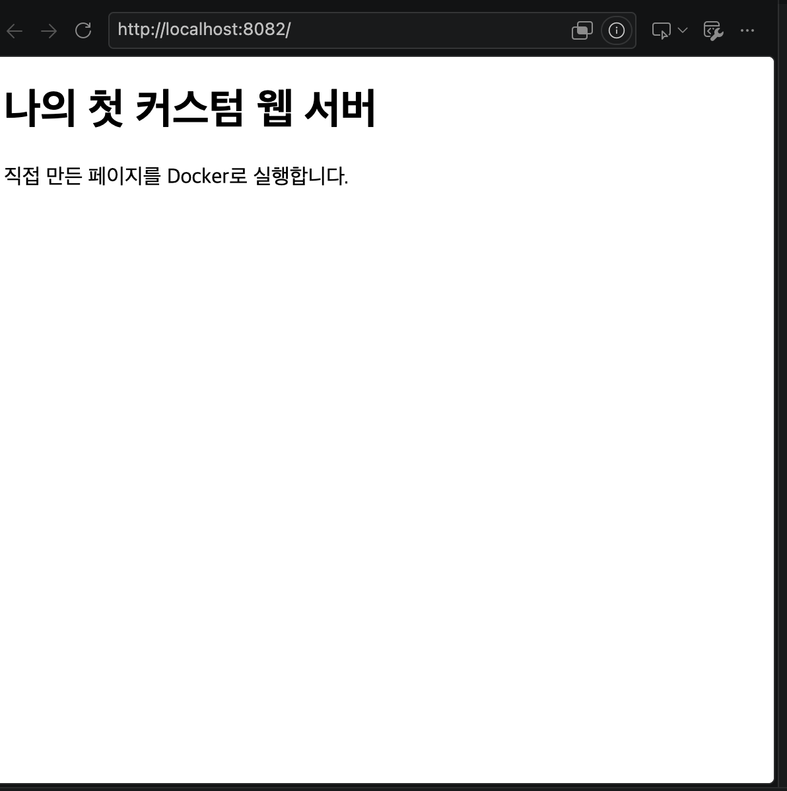
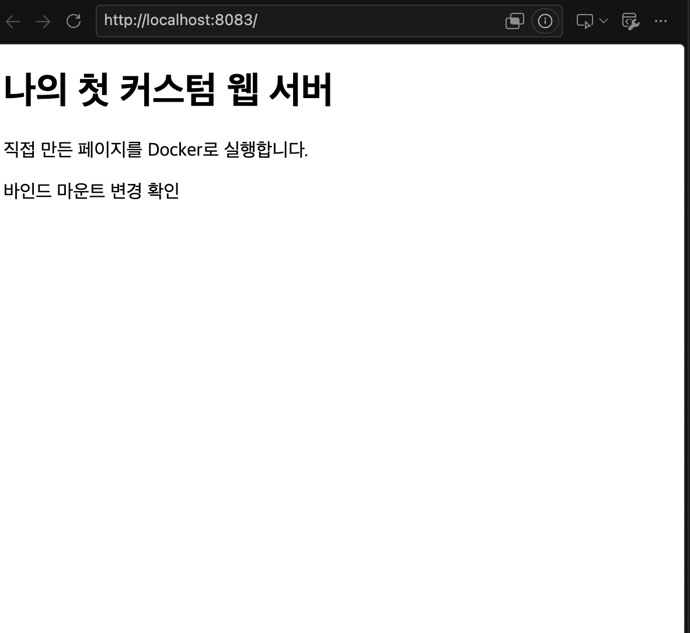
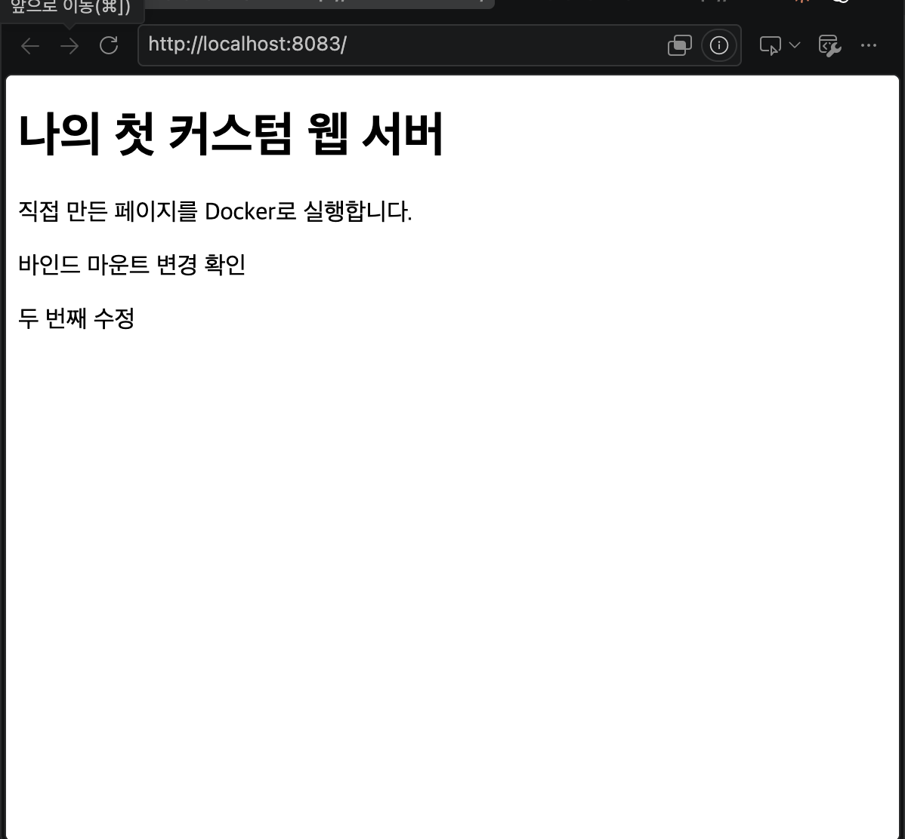
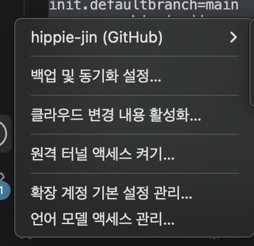
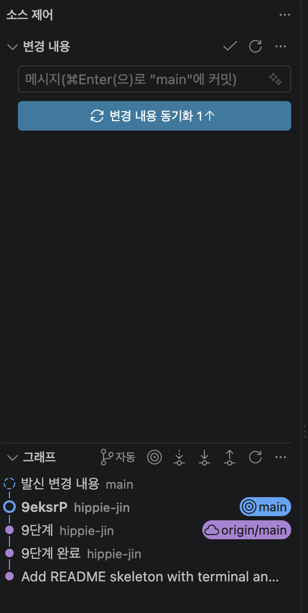

# Cody_All_E1-1 — 개발 워크스테이션 구축

## 1) 프로젝트 개요
터미널(CLI), Docker(OrbStack), Git/GitHub로 개발 환경을 직접 세팅하고, 실행 결과(로그·접속·데이터 유지)로 검증한다.

## 2) 실행 환경
- OS: macOS 15.7.9 (x86_64)
- Shell: bash 3.2.57 (터미널에 zsh 전환 안내가 뜨지만 bash 그대로 사용)
- Git: 2.39.5 (Apple Git-154)
- Docker: 29.8.2 (OrbStack 2.2.5, 컨테이너 엔진 포함)

## 2-1) 저장소 구조
```text
Cody_All_E1-1/
├── README.md        # 기술 문서 (전체 수행 내용의 진입점)
├── Dockerfile       # 커스텀 이미지 정의 (nginx:alpine + app/)
├── .gitignore       # 제출에서 제외할 로컬 파일 지정 (terminal-01/, .DS_Store)
├── app/             # 컨테이너가 서비스하는 웹 콘텐츠(소스)
│   └── index.html
├── logs/            # 명령 출력 로그 원본 (증거)
├── screenshots/     # 브라우저·VS Code 화면 (증거)
├── project/         # 4-1 터미널 조작 실습으로 만든 폴더
└── practice/        # 초기 터미널·권한 연습 파일
```

| 디렉토리/파일 | 역할 (1문장) |
|---|---|
| `README.md` | 개요, 환경, 체크리스트, 수행 로그, 검증 방법, 트러블슈팅을 담은 기술 문서이다. |
| `Dockerfile` | `nginx:alpine` 위에 `app/`을 복사해 커스텀 이미지를 만드는 레시피이다. |
| `app/` | 이미지에 복사되고 바인드 마운트로도 연결되는 웹 페이지 소스이다. |
| `logs/` | README에 붙이기 어려운 긴 명령 출력의 원본을 보관한다. |
| `screenshots/` | 포트 매핑, 바인드 마운트, GitHub 연동의 화면 증거를 보관한다. |
| `project/` | 파일·폴더 생성, 복사, 이동, 삭제 실습의 결과물이다. |
| `practice/` | 초기에 연습한 터미널·권한 실습 파일이다. |

**구성 기준**
- **실행 요소와 증거를 나눴다.** `Dockerfile`과 `app/`은 `docker build`·`docker run`에 쓰는 실행 요소이고, `logs/`와 `screenshots/`는 결과를 보여 주는 증거이다. 평가자가 실행 방법은 루트에서, 결과는 증거 폴더에서 바로 찾을 수 있다.
- **`Dockerfile`은 루트에 두었다.** `docker build .`의 빌드 컨텍스트가 저장소 루트라서 `COPY app/ ...`처럼 `app/`을 상대 경로로 참조할 수 있다.
- **소스(`app/`)를 분리했다.** 웹 콘텐츠만 `app/`에 두어, 이미지에 복사(`COPY`)하거나 컨테이너에 바인드 마운트할 때 대상 폴더를 하나로 고정했다.
- **연습 파일과 제출 대상을 구분했다.** 로컬 연습용 `terminal-01/`은 `.gitignore`로 제외하고, 제출에는 README에서 다루는 실습 결과만 포함했다.

## 3) 수행 체크리스트
- [x] 터미널 기본 조작 및 폴더 구성
- [x] 권한 변경 실습
- [x] Docker(OrbStack) 설치/점검
- [x] Docker 기본 운영 명령 (pull/images/run/ps/logs/stats/stop/start/rm)
- [x] hello-world / ubuntu 실행, attach/exec 차이 관찰
- [x] Dockerfile 빌드/실행 (커스텀 이미지)
- [x] 포트 매핑 접속(2회)
- [x] 바인드 마운트 반영
- [x] 볼륨 영속성
- [x] Git 설정 + GitHub/VSCode 연동

## 4) 수행 로그

### 4-1) 터미널 조작
검증: 현재 위치(`pwd`), 목록(`ls`, `ls -a`, `ls -la`), 이동(`cd`), 생성(`mkdir -p`, `touch`, `echo >`), 복사(`cp`), 이동·이름변경(`mv`), 내용 확인(`cat`), 삭제(`rm`, `rm -r`), 빈 파일 생성, 숨김 파일(`.hidden_config`).

```text
$ pwd
/Users/hwang-jinjeon/코디세이/올인원/Cody_All_E1-1
$ mkdir -p project/docs project/src
$ touch project/README.txt
$ echo "hello codtssey" > project/docs/note.txt
$ ls -la project
total 16
drwxr-xr-x@  6 hwang-jinjeon  staff   192 11  1 12:40 .
drwxr-xr-x  11 hwang-jinjeon  staff   352 11  1 12:38 ..
-rw-r--r--@  1 hwang-jinjeon  staff  6148 11  1 12:40 .DS_Store
drwxr-xr-x@  3 hwang-jinjeon  staff    96 11  1 12:40 docs
-rw-r--r--@  1 hwang-jinjeon  staff     0 11  1 12:39 README.txt
drwxr-xr-x@  2 hwang-jinjeon  staff    64 11  1 12:38 src
$ touch project/.hidden_config
$ ls
logs  practice  project  README.md  screenshots  terminal-01
$ ls -a
.  ..  .DS_Store  .git  .gitignore  logs  practice  project  README.md  screenshots  terminal-01

# project 로 이동 후 복사 / 이동 / 이름 변경
$ cd project
$ ls
docs  README.txt  src
$ cp README.txt READ.txt
$ ls
docs  READ.txt  README.txt  src
$ mv READ.txt docs/
$ ls
docs  README.txt  src
$ cd docs
$ mv READ.txt READ1.txt
$ ls
note.txt  READ1.txt
$ cat note.txt
hello codtssey

# 삭제: 파일은 rm, 폴더는 rm -r
$ rm READ1.txt
$ cd ..
$ rm -r docs
$ ls
README.txt  src
$ cat README.txt
$ pwd
/Users/hwang-jinjeon/코디세이/올인원/Cody_All_E1-1/project
```

- `ls`는 `.hidden_config`를 보여주지 않고 `ls -a`는 보여준다. 이름이 `.`으로 시작하면 숨김 파일이다.
- `mv READ.txt docs/`는 목적지가 **기존 폴더**라서 이동이고, `mv READ.txt READ1.txt`는 목적지가 **없는 이름**이라서 이름 변경이다.
- `cat README.txt`가 아무것도 출력하지 않은 것은 `touch`로 만든 빈 파일이기 때문이다.
- 절대 경로 이동은 오타로 실패했다(트러블슈팅 5-4). `pwd`가 보여주는 `/Users/...`가 절대 경로이다.

### 4-2) 권한 실습
검증: `ls -l`/`ls -ld`로 변경 전 권한을 확인하고, `chmod`(숫자 방식 `600`/`644`/`755`/`000`, 기호 방식 `u+x`)로 바꾼 뒤 다시 `ls -l`로 비교했다. 대상은 파일 1개(`file.txt`)와 디렉토리 1개(`mydir`)이다.

```text
# 준비
$ mkdir perm-lab
$ echo hello > file.txt
$ mv file.txt perm-lab/
$ cd perm-lab/
$ ls
file.txt
$ cat file.txt
hello
$ mkdir mydir
$ echo inside > mydir/inner.txt

# [파일] 변경 전
$ ls -l file.txt
-rw-r--r--@ 1 hwang-jinjeon  staff  6 11  1 18:44 file.txt
# [디렉토리] 변경 전
$ ls -ls mydir/
total 8
8 -rw-r--r--@ 1 hwang-jinjeon  staff  7 11  1 18:47 inner.txt
$ ls -ld mydir/
drwxr-xr-x@ 3 hwang-jinjeon  staff  96 11  1 18:47 mydir/

# [파일] 숫자 방식 600
$ chmod 600 file.txt
$ ls -l file.txt
-rw-------@ 1 hwang-jinjeon  staff  6 11  1 18:44 file.txt

# [파일] 644 복구 후 기호 방식 u+x
$ chmod 644 file.txt
$ ls -l file.txt
-rw-r--r--@ 1 hwang-jinjeon  staff  6 11  1 18:44 file.txt
$ chmod u+x file.txt
$ ls -l file.txt
-rwxr--r--@ 1 hwang-jinjeon  staff  6 11  1 18:44 file.txt

# [파일] 755
$ chmod 755 file.txt
$ ls -l file.txt
-rwxr-xr-x@ 1 hwang-jinjeon  staff  6 11  1 18:44 file.txt

# [디렉토리] 000: 접근 시도
$ chmod 000 mydir/
$ ls -ld mydir/
d---------  3 hwang-jinjeon  staff  96 11  1 18:47 mydir/
$ ls mydir/
ls: mydir/: Permission denied
$ cat mydir/inner.txt
cat: mydir/inner.txt: Permission denied

# [디렉토리] 644 (r 있음, x 없음): 접근 시도
$ chmod 644 mydir/
$ ls mydir/
inner.txt
ls: fts_read: Permission denied
$ cat mydir/inner.txt
cat: mydir/inner.txt: Permission denied

# [디렉토리] 755 복구
$ chmod 755 mydir/
$ ls -ld mydir/
drwxr-xr-x@ 3 hwang-jinjeon  staff  96 11  1 18:47 mydir/
$ ls mydir/
inner.txt
```

**결과 해석**

| 변경 | 문자열 | 해석 |
|---|---|---|
| 기본 | `-rw-r--r--` (644) | 소유자 rw(4+2=6), 그룹 r(4), 기타 r(4) |
| `chmod 600` | `-rw-------` | 소유자만 읽기·쓰기, 그룹·기타 권한 없음 |
| `chmod u+x` | `-rwxr--r--` (744) | 기호 방식: 소유자(user)에게 실행(x)만 추가 |
| `chmod 755` | `-rwxr-xr-x` | 소유자 rwx(7), 그룹 r-x(5), 기타 r-x(5) |
| 디렉토리 `chmod 000` | `d---------` | `ls`와 `cat` 모두 `Permission denied` |
| 디렉토리 `chmod 644` | `drw-r--r--` | `ls`는 이름(`inner.txt`)만 보이고 `fts_read: Permission denied`, `cat`은 거부 |

- 숫자 표기는 `r=4`, `w=2`, `x=1`을 더한 값이다. 755는 소유자 7(rwx), 그룹 5(r-x), 기타 5(r-x)이고, 644는 소유자 6(rw-), 그룹 4(r--), 기타 4(r--)이다.
- 디렉토리에서 `r`은 안에 있는 이름 목록을 보는 권한, `x`는 그 안으로 들어가 항목에 접근하는 권한이다. 644 실험에서 `r`만 있으면 이름은 보여도 파일 내용(`cat`)과 상세 정보에는 접근할 수 없었다.
- 파일 끝의 `@`는 macOS의 확장 속성 표시이며 권한 값은 아니다.

### 4-3) Docker(OrbStack) 설치 및 기본 점검
설치 방법: OrbStack 공식 사이트(orbstack.dev)의 dmg에서 `OrbStack.app`을 `/Applications`에 복사해 실행했다(`sudo` 미사용, 이유는 트러블슈팅 5-5). 앱 서명과 공증 검증 로그는 [logs/03_docker_setup.log](logs/03_docker_setup.log)에 있다.

검증: `docker --version`으로 클라이언트 버전, `docker info`의 Server 항목으로 데몬 동작을 확인했다(`Server Version`, `Operating System: OrbStack`가 출력되면 데몬이 응답하는 것이다).

```text
$ docker --version
Docker version 29.8.2, build 7fc2dff
$ docker info
Client:
 Version:    29.8.2
 Context:    orbstack
 Debug Mode: false
 Plugins:
  buildx: Docker Buildx (Docker Inc.)
    Version:  v0.37.2
    Path:     /Users/hwang-jinjeon/.docker/cli-plugins/docker-buildx
  compose: Docker Compose (Docker Inc.)
    Version:  v5.5.0
    Path:     /Users/hwang-jinjeon/.docker/cli-plugins/docker-compose

Server:
 Containers: 0
  Running: 0
  Paused: 0
  Stopped: 0
 Images: 0
 Server Version: 29.8.2
 Storage Driver: overlayfs
  driver-type: io.containerd.snapshotter.v1
 Logging Driver: json-file
 Cgroup Driver: cgroupfs
 Cgroup Version: 2
 Plugins:
  Volume: local
  Network: bridge host ipvlan macvlan null overlay
  Log: awslogs fluentd gcplogs gelf journald json-file local splunk syslog
 Swarm: inactive
 Runtimes: io.containerd.runc.v2 runc
 Default Runtime: runc
 containerd version: ee2735368117d2eb259779949d5e75cdafec9761
 runc version: 29dd3dc2b13b4123162e5fe132504bb4b15569f1
 Security Options:
  seccomp
   Profile: builtin
  cgroupns
 Kernel Version: 7.2.12-orbstack-00394-gbecdd6130068
 Operating System: OrbStack
 OSType: linux
 Architecture: x86_64
 CPUs: 8
 Total Memory: 3.892GiB
 Name: orbstack
 Docker Root Dir: /var/lib/docker
 Live Restore Enabled: false
 Product License: Community Engine
 (중략: CDI spec, Proxy, Default Address Pools 등 부가 항목)
```

### 4-4) Docker 기본 운영 명령
검증: `docker pull`/`docker images`(이미지), `docker run`/`docker ps`/`docker ps -a`(컨테이너 실행·목록), `docker exec`, `docker stats --no-stream`(리소스), `docker stop`/`docker start`, `docker logs`(로그).

```text
$ docker pull hello-world
Using default tag: latest
latest: Pulling from library/hello-world
4f55086f7dd0: Pull complete
d5e71e642bf5: Download complete
Digest: sha256:c567b231f65614688711a75f31518a064258a51d442117a3e771a3a8fdba78ef
Status: Downloaded newer image for hello-world:latest
docker.io/library/hello-world:latest
$ docker images
IMAGE                ID             DISK USAGE   CONTENT SIZE   EXTRA
hello-world:latest   c567b231f656       21.8kB         9.49kB

# 컨테이너 실행 (hello-world 출력은 4-5절 참고)
$ docker run --name first-hello hello-world
$ docker ps
CONTAINER ID   IMAGE     COMMAND   CREATED   STATUS    PORTS     NAMES
$ docker ps -a
CONTAINER ID   IMAGE         COMMAND    CREATED          STATUS                      PORTS     NAMES
b6705dcd4f9c   hello-world   "/hello"   58 seconds ago   Exited (0) 58 seconds ago             first-hello

# 백그라운드 실행 컨테이너 운영
$ docker run -d --name ubuntu-stay ubuntu sleep infinity
9ab04fea62439c5b0fbad1a39d78aaddd182477d3fee9775a4fb2697f118ce3d
$ docker ps
CONTAINER ID   IMAGE     COMMAND            CREATED         STATUS         PORTS     NAMES
9ab04fea6243   ubuntu    "sleep infinity"   9 seconds ago   Up 9 seconds             ubuntu-stay
$ docker stats --no-stream ubuntu-stay
CONTAINER ID   NAME          CPU %     MEM USAGE / LIMIT     MEM %     NET I/O         BLOCK I/O     PIDS
9ab04fea6243   ubuntu-stay   0.00%     2.141MiB / 3.892GiB   0.05%     1.13kB / 126B   31.8MB / 0B   1
$ docker stop ubuntu-stay
ubuntu-stay
$ docker ps -a --filter name=ubuntu-stay
CONTAINER ID   IMAGE     COMMAND            CREATED         STATUS                        PORTS     NAMES
9ab04fea6243   ubuntu    "sleep infinity"   7 minutes ago   Exited (137) 28 seconds ago             ubuntu-stay
$ docker start ubuntu-stay
ubuntu-stay
$ docker ps
CONTAINER ID   IMAGE     COMMAND            CREATED         STATUS         PORTS     NAMES
9ab04fea6243   ubuntu    "sleep infinity"   7 minutes ago   Up 8 seconds             ubuntu-stay

# 로그 확인 (종료된 컨테이너도 가능)
$ docker logs first-hello
(Hello from Docker! 메시지, 4-5절과 동일)
```

- `docker ps`는 실행 중인 컨테이너만, `docker ps -a`는 종료된 컨테이너까지 보여준다. `first-hello`는 `ps`에는 없고 `ps -a`에만 `Exited (0)`으로 나온다.
- `docker stop` 뒤 상태가 `Exited (137)`인 이유(추정): 137은 128+9로 SIGKILL을 뜻한다. `sleep infinity`가 PID 1이라 종료 신호(SIGTERM)에 반응하지 않아, 기본 대기 시간(10초) 후 강제 종료된 것으로 보인다.
- 이미지와 컨테이너는 분리되어 있다. `hello-world` 이미지 1개로 컨테이너 `first-hello`를 만들었고, 컨테이너가 종료되어도 이미지는 `docker images`에 남는다.

### 4-5) 컨테이너 실행 실습
검증: hello-world 성공 메시지, ubuntu 대화형 진입(`-it`) 후 `pwd`/`ls`/`echo`/`cat` 결과, `exec`와 `attach` 후 컨테이너 상태.

```text
# hello-world
$ docker run --name first-hello hello-world

Hello from Docker!
This message shows that your installation appears to be working correctly.

To generate this message, Docker took the following steps:
 1. The Docker client contacted the Docker daemon.
 2. The Docker daemon pulled the "hello-world" image from the Docker Hub.
    (amd64)
 3. The Docker daemon created a new container from that image which runs the
    executable that produces the output you are currently reading.
 4. The Docker daemon streamed that output to the Docker client, which sent it
    to your terminal.

# ubuntu 컨테이너 진입
$ docker run -it --name ubuntu-practice ubuntu bash
Unable to find image 'ubuntu:latest' locally
latest: Pulling from library/ubuntu
Status: Downloaded newer image for ubuntu:latest
root@8f1fff511371:/# pwd
/
root@8f1fff511371:/# ls
bin  boot  dev  etc  home  lib  lib64  media  mnt  opt  proc  root  run  sbin  srv  sys  tmp  usr  var
root@8f1fff511371:/# echo "inside ubuntu"
inside ubuntu
root@8f1fff511371:/# cat /etc/os-release
PRETTY_NAME="Ubuntu 26.04.1 LTS"
NAME="Ubuntu"
VERSION_ID="26.04"
(이하 생략)
root@8f1fff511371:/# exit
exit
$ docker ps -a
CONTAINER ID   IMAGE         COMMAND    CREATED         STATUS                      PORTS     NAMES
8f1fff511371   ubuntu        "bash"     3 minutes ago   Exited (0) 11 seconds ago             ubuntu-practice
b6705dcd4f9c   hello-world   "/hello"   8 minutes ago   Exited (0) 8 minutes ago              first-hello
```

#### exec 관찰: 나와도 컨테이너가 유지된다
```text
$ docker exec -it ubuntu-stay bash
root@9ab04fea6243:/# echo "extra bush"
extra bush
root@9ab04fea6243:/# exit
exit
$ docker ps
CONTAINER ID   IMAGE     COMMAND            CREATED         STATUS         PORTS     NAMES
9ab04fea6243   ubuntu    "sleep infinity"   2 minutes ago   Up 2 minutes             ubuntu-stay
```

#### attach 관찰: exit 하면 컨테이너가 종료된다
```text
$ docker run -dit --name attach-practice ubuntu bash
264d940e9361b69625ea3ed620dfc536b4fab2eb3827c386e36a22f6392c516b
$ docker attach attach-practice
root@264d940e9361:/# echo "attached to main bash"
attached to main bash
root@264d940e9361:/# exit
exit
$ docker ps
CONTAINER ID   IMAGE     COMMAND            CREATED          STATUS          PORTS     NAMES
9ab04fea6243   ubuntu    "sleep infinity"   24 minutes ago   Up 16 minutes             ubuntu-stay
$ docker attach attach-practice
cannot attach to a stopped container, start it first
$ docker start attach-practice
attach-practice
$ docker attach attach-practice
root@264d940e9361:/# exit
exit

# exit 대신 분리키로 빠져나오기 (컨테이너 유지)
$ docker start attach-practice
attach-practice
$ docker attach --detach-key="ctrl-g" attach-practice
unknown flag: --detach-key
$ docker attach --detach-keys="ctrl-g" attach-practice
root@264d940e9361:/# read escape sequence
$ docker ps -a --filter name=attach-practice
CONTAINER ID   IMAGE     COMMAND   CREATED          STATUS         PORTS     NAMES
264d940e9361   ubuntu    "bash"    34 minutes ago   Up 2 minutes             attach-practice
```

| 구분 | `docker exec` | `docker attach` |
|---|---|---|
| 연결 대상 | 실행 중인 컨테이너에 **새 프로세스**(bash)를 추가 실행 | 컨테이너의 **메인 프로세스(PID 1)** 에 연결 |
| `exit` 후 | 컨테이너 계속 실행 (`ubuntu-stay`는 `Up`) | 메인 프로세스가 끝나 컨테이너 종료 (`attach-practice`는 `Exited (0)`) |
| 빠져나오는 다른 방법 | 해당 없음 | 분리키(`--detach-keys`, Ctrl-p Ctrl-q가 기본)로 컨테이너를 유지한 채 분리 |
| 용도 | 실행 중 컨테이너 점검·디버깅 | 메인 프로세스의 입출력 확인 |

### 4-6) 커스텀 이미지 (Dockerfile 기반, 방식 A)
선택한 베이스: 공식 웹 서버 이미지 `nginx:alpine` + 내가 만든 정적 페이지(`app/index.html`)만 교체.

`Dockerfile` (저장소 루트, 빌드 컨텍스트는 `.`):
```dockerfile
FROM nginx:alpine

LABEL org.opencontainers.image.title="Codyssey Practice Web"
LABEL org.opencontainers.image.description="My first custom web image"

ENV APP_ENV=practice

COPY app/ /usr/share/nginx/html/
```

| 커스텀 포인트 | 목적 |
|---|---|
| `FROM nginx:alpine` | 이미 만들어진 웹 서버 이미지를 재사용한다. 직접 nginx를 설치하지 않는다. |
| `LABEL ...title/description` | 이미지에 이름·설명 메타데이터를 붙여 무엇인지 알 수 있게 한다. |
| `ENV APP_ENV=practice` | 컨테이너 안에서 읽을 수 있는 환경변수를 기본값으로 설정한다. |
| `COPY app/ /usr/share/nginx/html/` | 내 페이지를 nginx 웹 루트에 넣는다. **이미지를 빌드할 때** 실행되어 이미지 안에 파일이 포함된다. |

```text
$ docker build -t codyssey-web:1.0 .
[+] Building 3.1s (7/7) FINISHED
 => [internal] load build definition from dockerfile
 => [internal] load metadata for docker.io/library/nginx:alpine
 => [1/2] FROM docker.io/library/nginx:alpine@sha256:785835ea65db...
 (중략: 베이스 이미지 레이어 extracting)
 => [2/2] COPY app/ /usr/share/nginx/html/
 => exporting to image
 => => naming to docker.io/library/codyssey-web:1.0

$ docker run -d --name custom-web -p 8082:80 codyssey-web:1.0
182a3a537386ce6f093fec24f7d8fd63a77f0cf46a93933c4282df5cdc8991ce
$ docker exec custom-web printenv APP_ENV
practice
```

- `ENV`로 설정한 `APP_ENV=practice`가 실행 중인 컨테이너 안에서 `printenv`로 확인된다.
- 빌드 로그에 `[1/2]`, `[2/2]`가 나뉘는 것은 Dockerfile의 `FROM`, `COPY`가 각각 레이어가 되기 때문이다.

### 4-7) 포트 매핑과 바인드 마운트
```text
# 포트 매핑: 호스트 8082 -> 컨테이너 80 (위 4-6의 custom-web)
$ docker run -d --name custom-web -p 8082:80 codyssey-web:1.0

# 바인드 마운트: 호스트의 app 폴더를 컨테이너 웹 루트에 직접 연결 (읽기 전용), 호스트 8083 -> 컨테이너 80
$ docker run -d --name bind-web -p 8083:80 \
>   --mount type=bind,source="$(pwd)/app",target=/usr/share/nginx/html,readonly \
>   codyssey-web:1.0
fc6ca4c63b1f18752bc7dec35406fdadba5a2324e549691bd1f6c812f5d181e0

# 호스트에서 파일 수정
$ echo '<p>바인드 마운트 변경 확인</p>' >> app/index.html
```

- `-p 호스트포트:컨테이너포트` 형식이다. 컨테이너는 격리된 네트워크를 쓰므로, 호스트 포트를 컨테이너 포트에 연결해야 브라우저에서 접근할 수 있다. 같은 이미지를 8082, 8083 두 포트로 동시에 실행했다.
- 바인드 마운트는 호스트 경로를 컨테이너에 직접 연결한다. `source`는 절대 경로여야 해서 `$(pwd)/app`을 썼다.

**포트 매핑 접속 증거** (주소창의 포트와 응답 화면이 함께 보인다)

| 호스트 포트 | 컨테이너 | 접속 화면 |
|---|---|---|
| 8082 → 80 | `custom-web` (이미지 안에 `COPY`된 페이지) |  |
| 8083 → 80 | `bind-web` (호스트 `app/` 폴더를 바인드 마운트) |  |

- 같은 이미지(`codyssey-web:1.0`)를 서로 다른 호스트 포트 2개로 실행했고 둘 다 접속이 성공했다.
- 8083 화면에만 "바인드 마운트 변경 확인" 줄이 보인다. `bind-web`은 호스트의 `app/index.html`을 직접 읽어서 수정이 바로 반영되지만, `custom-web`(8082)은 빌드 시점에 이미지 안으로 복사된 파일을 쓰기 때문에 이후 수정이 반영되지 않는다.

**바인드 마운트 반영 증거: 같은 컨테이너(`bind-web`, 8083)에서 호스트 파일을 수정하기 전/후 비교**

```text
# 수정 전
$ curl localhost:8083
<!DOCTYPE html>
<html lang="ko">
<head>
  <meta charset="UTF-8">
  <title>나의 개발 작업실</title>
</head>
<body>
  <h1>나의 첫 커스텀 웹 서버</h1>
  <p>직접 만든 페이지를 Docker로 실행합니다.</p>
</body>
</html>
<p>바인드 마운트 변경 확인</p>

# 호스트에서 파일 수정 (컨테이너는 재시작하지 않음)
$ echo '<p>두 번째 수정</p>' >> app/index.html

# 수정 후
$ curl localhost:8083
<!DOCTYPE html>
<html lang="ko">
<head>
  <meta charset="UTF-8">
  <title>나의 개발 작업실</title>
</head>
<body>
  <h1>나의 첫 커스텀 웹 서버</h1>
  <p>직접 만든 페이지를 Docker로 실행합니다.</p>
</body>
</html>
<p>바인드 마운트 변경 확인</p>
<p>두 번째 수정</p>
```

| 수정 전 | 수정 후 |
|---|---|
|  |  |

- 컨테이너를 다시 만들거나 재시작하지 않았는데도 호스트의 `app/index.html` 수정이 응답에 바로 반영되었다. 바인드 마운트가 호스트 폴더를 컨테이너에 직접 연결하기 때문이다.
- 반대로 `custom-web`(8082)은 이미지에 복사된 파일을 사용하므로 같은 수정이 반영되지 않는다. 바인드 마운트는 개발 중 코드 수정을 바로 확인할 때, 이미지에 포함하는 방식(`COPY`)은 배포용으로 쓴다.

### 4-8) Docker 볼륨 영속성
```text
$ docker volume create practice-data
practice-data
$ docker run -d --name volume-first \
>   --mount type=volume,source=practice-data,target=/data \
>   ubuntu sleep infinity
6aca83865b96a462b5ae52bc2dfcc247da0577f001add739c692f043b1b76e12
$ docker exec volume-first sh -c 'echo "Data survives" > /data/proof.txt'
$ docker exec volume-first cat /data/proof.txt
Data survives

# 컨테이너 삭제
$ docker stop volume-first
volume-first
$ docker rm volume-first
volume-first

# 같은 볼륨을 새 컨테이너에 연결
$ docker run -d --name volume-second \
>   --mount type=volume,source=practice-data,target=/data \
>   ubuntu sleep infinity
ebaf6502c9b3f07a68c8cbcc9528d679bb88680120b3c0a0ff13fc10837852a6
$ docker exec volume-second cat /data/proof.txt
Data survives
```

- 첫 컨테이너(`volume-first`)를 삭제했는데도 새 컨테이너(`volume-second`)에서 `/data/proof.txt`가 그대로 읽힌다. 데이터는 컨테이너가 아니라 볼륨에 저장되어 있기 때문이다.

### 4-9) Git 설정
검증: `git config --list`로 사용자 이름, 이메일, 기본 브랜치(`init.defaultbranch=main`), 원격 저장소(`remote.origin.url`)를 확인했다. 이메일은 마스킹했다.

```text
$ git config --list
credential.helper=osxkeychain
init.defaultbranch=main
user.name=hippie-jin
user.email=h*******@naver.com
init.defaultbranch=main
core.repositoryformatversion=0
core.filemode=true
core.bare=false
core.logallrefupdates=true
core.ignorecase=true
core.precomposeunicode=true
remote.origin.url=https://github.com/hippie-jin/cody_all_E1-1.git
```

- `credential.helper=osxkeychain`: GitHub 인증 정보를 설정 파일이 아니라 macOS 키체인에 저장한다. 그래서 `remote.origin.url`에 토큰이 들어 있지 않다.
- `core.ignorecase=true`: macOS는 파일 이름의 대소문자를 구분하지 않아서 생긴 설정이다. `dockerfile`을 `Dockerfile`로 바꿔야 했던 이유와 연결된다.
- 이 저장소는 `remote.origin.url`로 GitHub(`hippie-jin/cody_all_E1-1`)와 연결되어 있다.

**VS Code GitHub 로그인 및 저장소 연동 증거**

| GitHub 로그인 (VS Code 계정 메뉴) | 저장소 연동 (VS Code 소스 제어) |
|---|---|
|  |  |

- 왼쪽: VS Code 계정 메뉴에 GitHub 계정 `hippie-jin (GitHub)`이 로그인된 상태로 표시된다.
- 오른쪽: 소스 제어 화면의 그래프에서 로컬 `main`과 원격 `origin/main`이 함께 표시되어, 이 저장소가 GitHub 원격 저장소와 연결되어 있음을 알 수 있다.

### 4-10) 포트 충돌 진단과 해제
상황: 이미 `custom-web`이 호스트 8082 포트를 쓰고 있는데, 같은 포트로 새 컨테이너를 실행해 충돌을 일으키고 원인 프로세스를 찾아 해제했다.

#### 1) 충돌 재현
```text
$ docker run -d --name conflict-web -p 8082:80 codyssey-web:1.0
3195654f4e4d34136e42b272dacceda4f68a2ac29e69c37d13a0e3182e01046e
docker: Error response from daemon: failed to set up container networking: driver failed programming external connectivity on endpoint conflict-web (bd9189fd07a8...): Bind for 0.0.0.0:8082 failed: port is already allocated

Run 'docker run --help' for more information
$ docker ps -a --filter name=conflict-web
CONTAINER ID   IMAGE              COMMAND                   CREATED        STATUS    PORTS     NAMES
3195654f4e4d   codyssey-web:1.0   "/docker-entrypoint.…"   1 second ago   Created             conflict-web

# 같은 이름으로 다시 실행하면 이름 충돌
$ docker run -d --name conflict-web -p 8082:80 codyssey-web:1.0
docker: Error response from daemon: Conflict. The container name "/conflict-web" is already in use by container "3195654f4e4d...". You have to remove (or rename) that container to be able to reuse that name.

# 남은 컨테이너를 지우고 다시 실행하면 같은 포트 오류가 재현된다
$ docker rm conflict-web
conflict-web
$ docker run -d --name conflict-web -p 8082:80 codyssey-web:1.0
d82e075da956ab6abf051585f64e2d0541e056e4b39eb93804cffc2c59568895
docker: Error response from daemon: failed to set up container networking: driver failed programming external connectivity on endpoint conflict-web (0a935a56dfaa...): Bind for 0.0.0.0:8082 failed: port is already allocated
$ docker ps -a --filter name=conflict-web
CONTAINER ID   IMAGE              COMMAND                   CREATED          STATUS    PORTS     NAMES
d82e075da956   codyssey-web:1.0   "/docker-entrypoint.…"   13 seconds ago   Created             conflict-web
```

#### 2) 포트를 사용 중인 프로세스 찾기
```text
$ docker ps --format 'table {{.Names}}\t{{.Ports}}'
NAMES             PORTS
volume-second
bind-web          0.0.0.0:8083->80/tcp, [::]:8083->80/tcp
custom-web        0.0.0.0:8082->80/tcp, [::]:8082->80/tcp
attach-practice
ubuntu-stay
$ docker port custom-web
80/tcp -> 0.0.0.0:8082
80/tcp -> [::]:8082
$ lsof -nP -iTCP:8082 -sTCP:LISTEN
COMMAND     PID          USER   FD   TYPE             DEVICE SIZE/OFF NODE NAME
OrbStack  56164 hwang-jinjeon  103u  IPv4 0xcdbb2b330883d35d      0t0  TCP *:8082 (LISTEN)
OrbStack  56164 hwang-jinjeon  104u  IPv6 0xfa560e7b5647c48e      0t0  TCP *:8082 (LISTEN)
$ netstat -an -p tcp | grep 8082
tcp46      0      0  *.8082                 *.*                    LISTEN
tcp4       0      0  *.8082                 *.*                    LISTEN
```

- `docker ps`/`docker port`로 8082가 `custom-web`에 매핑되어 있음을 확인했다.
- `lsof`의 `COMMAND`가 nginx가 아니라 `OrbStack`(PID 56164)으로 나온다. OrbStack이 호스트 포트를 대신 열어 두고 컨테이너로 전달하기 때문으로 보인다(추정). 따라서 이 PID는 `kill`하면 안 된다.
- `-n`은 호스트 이름 변환을, `-P`는 포트 이름 변환을 끄고 숫자로 보여 주는 옵션이다. `-sTCP:LISTEN`은 대기(LISTEN) 상태만 보여 준다.

#### 3) 해제 방법 A: 다른 호스트 포트로 실행
```text
$ docker rm conflict-web
conflict-web
$ docker run -d --name conflict-web -p 8090:80 codyssey-web:1.0
0eef6ff4849aee7f166f140cd054e4268eea228aad29bac78ded81554e358f5e
$ curl -s localhost:8090 | head -3
<!DOCTYPE html>
<html lang="ko">
<head>
```

#### 4) 해제 방법 B: 기존 컨테이너를 중지해 포트 해제
```text
$ docker stop custom-web
custom-web
$ lsof -nP -iTCP:8082 -sTCP:LISTEN; echo "exit=$?"
exit=1
$ docker start custom-web
custom-web
$ docker ps --format 'table {{.Names}}\t{{.Ports}}'
NAMES             PORTS
conflict-web      0.0.0.0:8090->80/tcp, [::]:8090->80/tcp
volume-second
bind-web          0.0.0.0:8083->80/tcp, [::]:8083->80/tcp
custom-web        0.0.0.0:8082->80/tcp, [::]:8082->80/tcp
attach-practice
ubuntu-stay
```

- 컨테이너를 중지하면 `lsof`가 아무것도 출력하지 않는다(`exit=1`). 다시 시작하면 8082 매핑이 복구된다.

#### 5) 일반 프로세스를 찾아 종료하는 절차
터미널 A에서 8091 포트를 쓰는 간단한 서버를 실행하고, 터미널 B에서 찾아서 종료했다.
```text
# 터미널 A
$ python3 -m http.server 8091
Serving HTTP on :: port 8091 (http://[::]:8091/) ...
Terminated: 15

# 터미널 B
$ lsof -nP -iTCP:8091 -sTCP:LISTEN
COMMAND   PID          USER   FD   TYPE             DEVICE SIZE/OFF NODE NAME
Python  74473 hwang-jinjeon    4u  IPv6 0x74860ab653eeb583      0t0  TCP *:8091 (LISTEN)
$ kill 74473
$ lsof -nP -iTCP:8091 -sTCP:LISTEN; echo "exit=$?"
exit=1
```

- 절차: ① `lsof`로 PID 확인 → ② `kill PID`(기본 신호 SIGTERM, 15) → ③ `lsof`로 사라졌는지 확인. 터미널 A의 `Terminated: 15`가 SIGTERM으로 종료되었다는 표시이다.
- 정상 종료되지 않을 때만 마지막 수단으로 `kill -9 PID`(SIGKILL)를 쓴다.

#### 6) 정리
```text
$ docker rm -f conflict-web
conflict-web
$ docker ps --format 'table {{.Names}}\t{{.Ports}}'
NAMES             PORTS
volume-second
bind-web          0.0.0.0:8083->80/tcp, [::]:8083->80/tcp
custom-web        0.0.0.0:8082->80/tcp, [::]:8082->80/tcp
attach-practice
ubuntu-stay
```

#### 포트 확인 명령 정리
| 목적 | macOS (이 실습) | Linux (참고, 실행하지 않음) |
|---|---|---|
| 포트를 쓰는 프로세스 찾기 | `lsof -nP -iTCP:8082 -sTCP:LISTEN` | `ss -tlnp \| grep :8082`, `lsof -i :8082` |
| 대기 중인 포트 목록 | `netstat -an -p tcp \| grep LISTEN` | `ss -tln` |
| 프로세스 종료 | `kill PID` (필요하면 `kill -9 PID`) | 동일 |

- macOS에는 `ss` 명령이 없다. `ss`는 Linux 전용이라 이 실습에서는 `lsof`와 `netstat`을 사용했다.

## 5) 트러블슈팅
### 5-1) `docker run -- name ...` 에서 이미지를 찾지 못함
- 문제: `docker run -- name first-hello hello-world` 실행 시 `Unable to find image 'name:latest' locally`, `pull access denied for name`
- 원인 가설: `--`와 `name` 사이에 공백이 있어 `--name` 옵션이 아니라, `name`이 이미지 이름으로 해석되었다.
- 확인: 에러가 찾지 못한 이미지 이름이 `name:latest`였다. 오타 없이 `--name`으로 실행하자 성공했다.
- 해결: `docker run --name first-hello hello-world`

### 5-2) 명령 오타(`sleelp`)로 컨테이너가 시작되지 않고, 같은 이름으로 재실행하면 충돌
- 문제: `docker run -d --name ubuntu-stay ubuntu sleelp infinity` → `exec: "sleelp": executable file not found in $PATH`. 다시 정상 명령으로 실행하면 `The container name "/ubuntu-stay" is already in use`
- 원인 가설: 컨테이너는 만들어졌지만 실행할 명령이 없어 시작에 실패했고, 만들어진 컨테이너가 이름을 계속 점유한다.
- 확인: `docker ps -a --filter name=ubuntu-stay`에서 `STATUS`가 `Created`였다. `docker start`도 같은 오류로 실패했다.
- 해결: `docker rm ubuntu-stay`로 지운 뒤 `docker run -d --name ubuntu-stay ubuntu sleep infinity`로 다시 실행했다. 실행에 실패해도 컨테이너는 남을 수 있다는 점을 확인했다.

### 5-3) `docker attach` 가 "cannot attach to a stopped container"
- 문제: `docker attach attach-practice`에서 `cannot attach to a stopped container, start it first`
- 원인 가설: 앞서 `attach`한 상태에서 `exit`를 입력해 메인 프로세스(bash)가 종료되며 컨테이너도 종료되었다.
- 확인: `exit` 직후 `docker ps`에 해당 컨테이너가 없었고, `docker ps -a`에서 `Exited (0)`이었다.
- 해결: `docker start attach-practice`로 다시 시작한 뒤 `attach`했다. 종료 없이 빠져나오려면 `--detach-keys`를 쓴다(옵션 이름은 `--detach-key`가 아니라 `--detach-keys`).

### 5-4) 절대 경로 `cd` 실패
- 문제: `cd /user/hwang-jinjeon/코디세이/올인워/Cody_All_E1-1/priject/src` → `No such file or directory`
- 원인 가설: 경로 일부를 잘못 입력했다. `/user`(올바른 값은 `/Users`), `올인워`(올바른 값은 `올인원`), `priject`(올바른 값은 `project`).
- 확인: `pwd`로 실제 절대 경로(`/Users/hwang-jinjeon/코디세이/올인원/Cody_All_E1-1/project`)를 확인해 비교했다.
- 해결: 절대 경로는 글자 하나라도 틀리면 실패하므로, `pwd` 출력을 복사해 쓰거나 `Tab` 자동완성을 사용한다.

### 5-5) OrbStack `brew install --cask orbstack` 실패
- 문제: `Error: The following directories are not writable by your user: /usr/local/share/man/man8`로 설치가 중단되었다.
- 원인 가설: Homebrew가 root 소유 디렉토리에 심볼릭 링크(man 문서)를 만들지 못했다. 보안 정책상 `sudo` 사용이 제한될 수 있다.
- 확인: `ls -ld /usr/local/share/man/man8`의 소유자가 `root`였고, `sudo -n true`는 `a password is required`를 반환했다. 내 계정은 `admin` 그룹이어서 `/Applications`(root:admin, 775)에는 쓸 수 있었다.
- 해결: 권한을 바꾸지 않고, 공식 dmg를 받아 서명(`Developer ID: Orbital Labs, LLC`)과 Apple 공증을 확인한 뒤 `/Applications`에 직접 복사했다.

### 5-6) 설치 직후 `docker: command not found`
- 문제: OrbStack을 실행한 직후 같은 셸에서 `docker --version`이 실패했다.
- 원인 가설: 이미 열려 있던 셸은 OrbStack이 추가한 PATH 설정을 아직 읽지 않았다.
- 확인: `~/.orbstack/bin/docker` 링크가 생성돼 있었고, `~/.bash_profile` 끝에 `source ~/.orbstack/shell/init.bash`가 추가돼 있었다.
- 해결: 새 로그인 셸(`bash -l`)에서 `docker`가 `/usr/local/bin/docker`로 잡혔다. 기존 터미널은 새로 열어야 한다.

### 5-7) 포트 충돌: `port is already allocated`
- 문제: `docker run -d --name conflict-web -p 8082:80 codyssey-web:1.0` 실행 시 `Bind for 0.0.0.0:8082 failed: port is already allocated`가 발생했다. 같은 이름으로 다시 실행하면 `container name ... is already in use`도 발생했다.
- 원인 가설: 호스트 8082 포트를 이미 다른 컨테이너(`custom-web`)가 사용 중이다. 실패한 컨테이너는 만들어진 채 남아(`Created`) 이름도 점유한다.
- 확인: `docker ps`, `docker port custom-web`, `lsof -nP -iTCP:8082 -sTCP:LISTEN`, `netstat -an -p tcp | grep 8082`로 8082 사용 여부를 확인했다. `lsof`에는 `OrbStack`(PID 56164)이 나왔다. `docker ps -a`에서 실패한 컨테이너가 `Created`로 남은 것을 확인했다. 자세한 로그는 [4-10](#4-10-포트-충돌-진단과-해제)에 있다.
- 해결: 남은 컨테이너를 `docker rm conflict-web`으로 지운 뒤 ① 다른 호스트 포트(`-p 8090:80`)로 실행하거나 ② 기존 컨테이너를 `docker stop custom-web`으로 중지해 포트를 풀었다. Docker 컨테이너가 연 포트의 PID는 OrbStack이므로 `kill`하지 않고 `docker stop`/`docker rm`으로 푼다. 컨테이너가 아닌 일반 프로세스는 `lsof`로 PID를 찾아 `kill`한다.

## 6) 검증 방법 요약
| 항목 | 사용한 명령 | 확인한 내용 | 결과 위치 |
|---|---|---|---|
| 터미널 조작 | `pwd`, `ls -la`, `cd`, `mkdir -p`, `touch`, `cp`, `mv`, `cat`, `rm`, `rm -r` | 위치·목록(숨김 파일 포함)·이동·생성·복사·이름 변경·삭제·내용 확인 | [4-1](#4-1-터미널-조작) |
| 권한 | `ls -l`, `ls -ld`, `chmod 600/644/755/000`, `chmod u+x` | 변경 전/후 권한 문자열 비교, 디렉토리 `r`/`x` 차이 | [4-2](#4-2-권한-실습) |
| Docker 설치/점검 | `docker --version`, `docker info` | 클라이언트 버전, 데몬(Server) 응답 | [4-3](#4-3-dockerorbstack-설치-및-기본-점검), [logs/03_docker_setup.log](logs/03_docker_setup.log) |
| Docker 운영 | `docker pull/images/ps/ps -a/logs/stats/stop/start` | 이미지 목록, 실행 중/종료 컨테이너, 로그, 리소스 | [4-4](#4-4-docker-기본-운영-명령) |
| 컨테이너 실행 | `docker run hello-world`, `docker run -it ubuntu bash`, `docker exec`, `docker attach` | 정상 실행, 내부 명령 수행, exit 후 컨테이너 상태 차이 | [4-5](#4-5-컨테이너-실행-실습) |
| 커스텀 이미지 | `docker build -t codyssey-web:1.0 .`, `docker exec custom-web printenv APP_ENV` | 빌드 성공, `ENV` 반영(`practice`) | [4-6](#4-6-커스텀-이미지-dockerfile-기반-방식-a), [Dockerfile](Dockerfile) |
| 포트 매핑 | `docker run -p 8082:80`, `-p 8083:80`, 브라우저 접속 | 주소창 포트와 응답 화면 | [4-7](#4-7-포트-매핑과-바인드-마운트), `screenshots/07_*` |
| 바인드 마운트 | `docker run --mount type=bind`, `curl localhost:8083` 전/후 | 호스트 파일 수정이 재시작 없이 반영 | [4-7](#4-7-포트-매핑과-바인드-마운트), `screenshots/08_*` |
| 볼륨 영속성 | `docker volume create`, `docker rm`, 새 컨테이너 연결 후 `cat` | 컨테이너 삭제 후에도 데이터 유지 | [4-8](#4-8-docker-볼륨-영속성) |
| 포트 충돌 진단 | `docker ps`, `docker port`, `lsof -nP -iTCP:8082 -sTCP:LISTEN`, `netstat -an -p tcp`, `kill PID` | 충돌 오류 재현, 사용 중인 프로세스 확인, 포트 해제 | [4-10](#4-10-포트-충돌-진단과-해제), [5-7](#5-7-포트-충돌-port-is-already-allocated) |
| Git 설정/연동 | `git config --list`, VS Code 로그인·소스 제어 화면 | 사용자·브랜치·원격 설정, GitHub 연동 | [4-9](#4-9-git-설정), `screenshots/10_*` |

## 7) 재현 방법 및 주의사항
1. **경로:** 로그의 `/Users/hwang-jinjeon/...`는 내 PC 경로이다. 본인 환경에서는 저장소를 받은 폴더에서 `pwd`로 확인한 경로를 사용한다.
2. **Docker 준비:** macOS는 OrbStack 앱을 먼저 실행해야 `docker` 명령이 동작한다. 서울캠퍼스처럼 `sudo`가 제한된 환경에서는 `brew install --cask orbstack`이 실패할 수 있다(트러블슈팅 5-5). 이 경우 공식 dmg를 받아 `/Applications`에 복사한다.
3. **이미지 빌드:** 저장소 루트에서 `docker build -t codyssey-web:1.0 .`를 실행한다. `Dockerfile`과 `app/index.html`이 필요하다.
4. **실행:** `docker run -d --name custom-web -p 8082:80 codyssey-web:1.0` 후 `http://localhost:8082`에 접속한다. 8082나 8083 포트가 이미 사용 중이면 다른 호스트 포트(예: 8090)로 바꾼다. 사용 중인 프로세스를 찾는 방법은 4-10절을 따른다. 컨테이너 이름이 충돌하면 `docker rm -f 이름`으로 지우고 다시 실행한다(트러블슈팅 5-2).
5. **바인드 마운트:** `--mount type=bind,source="$(pwd)/app",...`의 `source`는 절대 경로여야 하므로 반드시 저장소 루트에서 실행한다.
6. **셸:** 로그는 macOS의 bash 3.2 기준이다. zsh에서도 같은 명령이 동작한다.
7. **보안:** 이메일은 마스킹했고, 인증 정보는 macOS 키체인에 저장되어 저장소에 포함되지 않는다.
